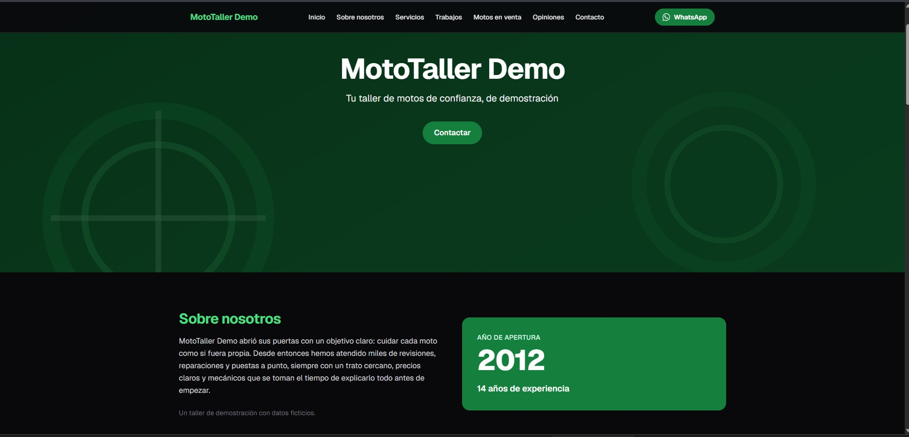
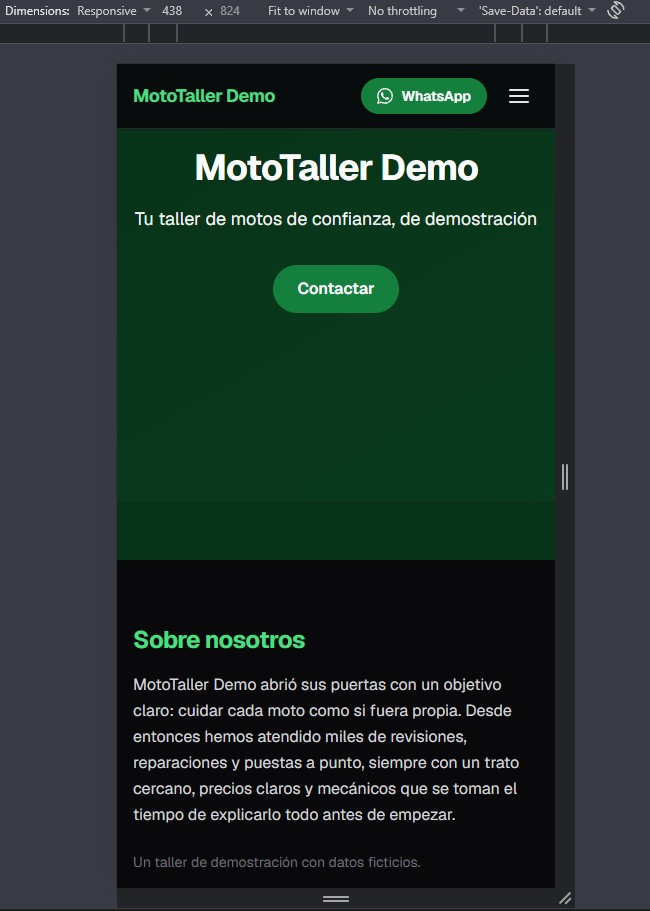
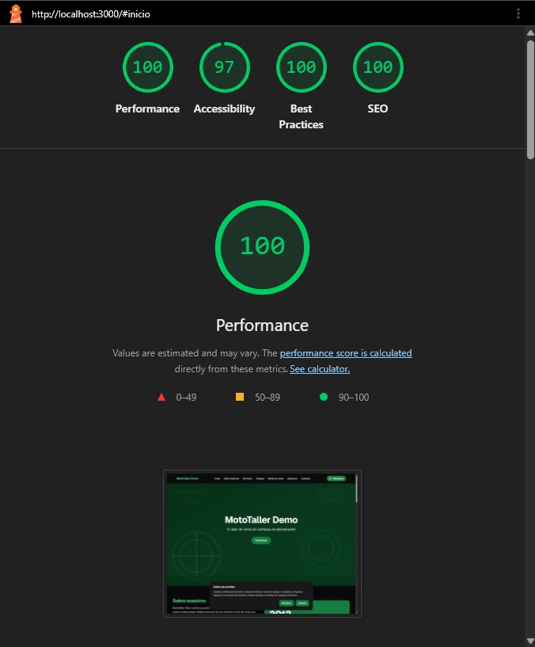
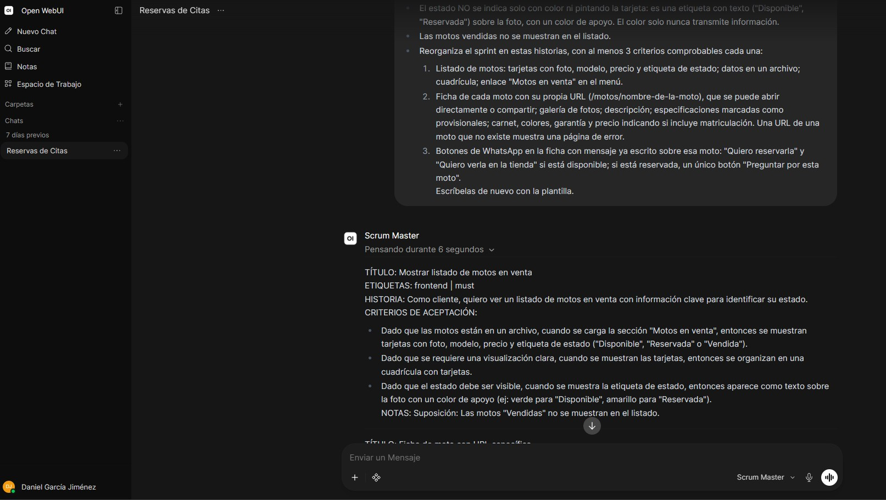

# MotoTaller Demo — plataforma web para un taller de motos

Plataforma web para un taller de motos, construida como proyecto personal de aprendizaje con un
taller ficticio. El objetivo no es solo el producto: es **desarrollarlo con un equipo de agentes de
IA organizados en sprints**, manteniendo yo el control de la arquitectura, la revisión del código y
lo que entra en `main`.

> **Estado:** en desarrollo. Sprint 1 cerrado (12/12 issues), Sprint 2 en curso.
> Todos los datos, nombres y textos de la web son ficticios.

---

## Por qué este repositorio es diferente

El código lo escriben tres agentes con roles separados; yo hago de product owner y de revisor.

| Agente | Rol | Modelo |
|---|---|---|
| **Scrum** | Me entrevista para levantar requisitos y descompone cada sprint en issues priorizadas (MoSCoW) | Qwen3 8B, autoalojado en local con Ollama |
| **Frontend** | Implementa las issues de interfaz | DeepSeek v4 Flash, vía API de OpenRouter |
| **Backend** | Implementa las issues de servidor | DeepSeek v4 Flash, vía API de OpenRouter |

Es una **inferencia híbrida** deliberada: el agente que maneja los requisitos del negocio corre en
local, y los que generan código usan un modelo remoto más potente.

Las reglas con las que trabajan los agentes están en [`AGENTS.md`](AGENTS.md): stack cerrado,
convención de ramas y commits, prohibición de hacer `push`, y una Definición de Hecho explícita.
**Ningún agente sube nada**: yo reviso cada cambio y hago el merge a `main` a mano.

---

## Stack

**Funcionando ahora**

- **Frontend:** Next.js · React · TypeScript · Tailwind CSS
- **Contenedores:** Docker Compose
- **Entorno de desarrollo:** WSL (Ubuntu) sobre Windows 11, con VS Code acoplado al subsistema

**Planificado para fases posteriores** *(declarado en `AGENTS.md`, aún no levantado)*

- **Backend:** Spring Boot (Java 21)
- **Base de datos:** PostgreSQL
- **Autenticación:** Keycloak

---

## Cómo levantarlo

Ahora mismo `compose.yaml` define **solo el servicio de frontend**.

```bash
git clone https://github.com/danigj91x/taller_motos_CRM.git
cd taller_motos_CRM
docker compose up --build
```

La web queda en **http://localhost:3000**.

| | |
|---|---|
| Servicio | `frontend` (`mototaller-frontend`) |
| Puerto | `3000:3000` |
| Variables | `NODE_ENV=production`, `NEXT_TELEMETRY_DISABLED=1` |

No hace falta ningún `.env` para arrancar el frontend. Cuando entren el backend, la base de datos y
Keycloak, sus variables se documentarán en un `.env.example`.

---

## Estructura

```
.
├── agents/      Configuración y prompts de los agentes
├── backend/     Spring Boot (fase posterior)
├── docs/        Documentación del proyecto
├── frontend/    Next.js + React + TypeScript
├── infra/       Infraestructura y despliegue
├── AGENTS.md    Reglas de trabajo para los agentes
└── compose.yaml
```

---

## Cómo se trabaja aquí

**Ramas** — una por issue, nunca se commitea en `main`:

```
feature/<numero-issue>-<descripcion-corta>
```

**Commits** — en español, con prefijo: `feat:`, `fix:`, `docs:`, `chore:`

**Definición de Hecho** — una issue no se cierra hasta que:

- [x] Se ve bien a 375 px y a 1440 px
- [x] Respeta la paleta, definida en un único sitio de la configuración de Tailwind
- [x] Cumple contraste **WCAG AA** (4,5:1 — por eso los fondos con texto blanco usan `primary-700` o más oscuro)
- [x] Usa datos ficticios
- [x] `npm run build` termina sin errores

La accesibilidad se audita con **Lighthouse**. La portada va por 97 y hay una issue abierta para el
fallo que queda.

---

## Hoja de ruta

| Fase | Contenido | Estado |
|---|---|---|
| 1 | Web base, sin login ni base de datos | ✅ Sprint 1 cerrado, 12/12 |
| 2 | Motos en venta: catálogo y fichas, sin backend | 🔄 En curso |
| 3 | Reserva de citas | ⏳ |
| 4 | Área de clientes con historial exportable | ⏳ |

---

## Capturas

<!-- SUSTITUIR: guarda las imagenes en docs/capturas/ y descomenta este bloque.
     Chrome: F12 > icono movil > Responsive 1440 o iPhone SE 375;
     Ctrl+Shift+P > "Capture full size screenshot".
     Lighthouse esta en su propia pestana dentro de F12.
     Que en las capturas solo salga el taller ficticio.

### La web

| Escritorio (1440 px) | Movil (375 px) |
|---|---|
|  |  |

### Accesibilidad



### El agente Scrum levantando requisitos


-->

---

## Sobre el proyecto

Proyecto personal de **Daniel García Jiménez** — Técnico Superior en ASIX y en DAM, cursando el Grado
en Ingeniería Informática con mención en Ciberseguridad.

[LinkedIn](https://linkedin.com/in/danielgarjim)
